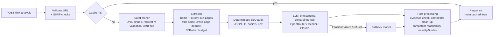

# AI-Powered Website Link Analysis API

A FastAPI service that reads a company's website and uses an LLM (free OpenRouter models, Google Gemini, or Anthropic Claude) to return a
**structured, evidence-checked** analysis in five sections:

1. **Competitor vs your brand**: brand profile, 3+ competitors with strengths and gaps, a comparison table, advantages and opportunities
2. **Top 5 target search queries**: one per platform (Google, Facebook, Instagram, LinkedIn, X), each with intent, relevance and audience
3. **SEO improvements**: keywords, a recommended title and meta description, content ideas, plus a **measured HTML audit**
4. **Top 5 services**: each with a verbatim quote from the site that is **checked against the page text**
5. **Target audience**: primary and secondary audiences, segments, customer profiles, geography, needs and marketing segments

| | |
|---|---|
| **Live demo** | https://ai-link-analysis-ie90.onrender.com/docs *(free instance, the first request after idle takes ~50 s to wake up)* |
| **Endpoint** | `POST /link-analysis` on port `4000` |
| **Stack** | Python 3.10+, FastAPI, Uvicorn, Pydantic v2, HTTPX, BeautifulSoup + lxml, Anthropic SDK |
| **LLM providers** | **OpenRouter (default, free models)**, any OpenAI-compatible API (Gemini free tier, Groq, OpenAI...), or Anthropic Claude. Switch with one env var. |
| **Production recommendation** | `claude-haiku-5-5` (≈ $0.004 per analysis), falling back to `claude-sonnet-5-5`; see the [LLM research](#7-llm-platform--model-research) |
| **Tests** | 92 automated tests; they run offline with no API key |

---

## Contents
1. [What makes this implementation different](#1-what-makes-this-implementation-different)
2. [Quick start](#2-quick-start)
3. [API reference](#3-api-reference)
4. [Architecture & processing flow](#4-architecture--processing-flow)
5. [How accuracy is enforced](#5-how-accuracy-is-enforced-anti-hallucination)
6. [Security](#6-security)
7. [LLM platform & model research](#7-llm-platform--model-research)
8. [Testing](#8-testing)
9. [Deployment](#9-deployment)
10. [Project structure](#10-project-structure)
11. [Limitations & next steps](#11-limitations--next-steps)

---

## 1. What makes this implementation different

| Requirement | How it is met |
|---|---|
| Use actual website content | Fetches the home page **plus up to 4 high-value sub-pages** (services, products, about, pricing...). These are picked by a link scorer, and boilerplate repeated across pages (menus, footers, cookie banners) is removed. |
| Structured JSON from the LLM | Uses Claude **schema-constrained structured output** (`messages.parse(output_format=PydanticModel)`). The model cannot return malformed JSON, and the result is validated again by Pydantic. |
| No generic or hallucinated results | Every service quote is **checked against the scraped text** (`evidence_verified`). Competitor homepages are **probed for reachability** (`website_status`). The brand itself and duplicates are removed from the competitor list. |
| SEO grounded in facts | A **deterministic HTML audit** (title and meta lengths, H1s, alt text, canonical, Open Graph, JSON-LD, HTTPS, viewport, word count) is computed without AI. The LLM receives it as input, and it is also returned as is. |
| Don't invent search volumes | No volume data source is connected, so `search_volume` is always `null` and the response says why. |
| Competitors credible or labelled | Each competitor has `source: "ai_suggestion"`, a `confidence` value, a reachability check and a disclaimer. |
| SSRF protection | Only public IP addresses are allowed. **DNS pinning** blocks DNS rebinding, every redirect is re-validated, and ports are restricted. See [Security](#6-security). |
| Graceful failures | Every error uses one JSON shape with a stable `code` (`INVALID_URL`, `BLOCKED_URL`, `WEBSITE_TIMEOUT`, `LLM_ERROR`, ...) and a `request_id`. |
| Cost, speed and observability | The response reports **measured tokens, USD cost and per-stage latency**. Results are cached per URL, concurrent identical requests share one LLM call, and the system prompt is prompt-cached. |
| Resilience | Falls back from the primary to a secondary model on overload, rate limit, timeout, refusal, truncation or invalid output. Free models get a JSON-mode fallback and one self-repair round. |
| Provider-agnostic | One `AnalysisLLM` interface with two implementations: Claude (official SDK) and OpenAI-compatible (`/chat/completions`). It runs **free** on OpenRouter or Gemini, or on paid Claude for production quality. |

---

## 2. Quick start

```bash
git clone https://github.com/rajatmurhe/ai-link-analysis.git
cd ai-link-analysis
python3 -m venv .venv && source .venv/bin/activate
pip install -r requirements.txt
cp .env.example .env          # then put your API key in .env (see below)
uvicorn app.main:app --host 0.0.0.0 --port 4000
```

**Choosing an LLM (all switches are in `.env`):**

| Option | Cost | Get a key | `.env` |
|---|---|---|---|
| **A. OpenRouter free models** (default) | Free, rate-limited | https://openrouter.ai/keys | `LLM_PROVIDER=openrouter`<br>`LLM_API_KEY=sk-or-...` |
| B. Google Gemini (free tier) | Free, rate-limited | https://aistudio.google.com/apikey | `LLM_PROVIDER=openai_compatible`<br>`LLM_BASE_URL=https://generativelanguage.googleapis.com/v1beta/openai/`<br>`LLM_API_KEY=...`<br>`LLM_MODEL=gemini-3.5-flash-lite` |
| C. Anthropic Claude (recommended for production) | ≈ $0.004 / analysis | https://platform.claude.com/settings/keys | `LLM_PROVIDER=anthropic`<br>`ANTHROPIC_API_KEY=sk-ant-...` |

* Swagger UI: http://localhost:4000/docs
* ReDoc: http://localhost:4000/redoc
* Health: http://localhost:4000/health

With Docker:

```bash
docker build -t ai-link-analysis .
docker run -p 4000:4000 --env-file .env ai-link-analysis
```

All settings are environment variables; see [`.env.example`](.env.example). API keys are read
only from the environment and are never logged or returned.

---

## 3. API reference

### `POST /link-analysis`

```bash
curl -X POST http://localhost:4000/link-analysis \
  -H "Content-Type: application/json" \
  -d '{"url": "https://basecamp.com"}'
```

| Field | Type | Description |
|---|---|---|
| `url` | string, required | Public website URL. `https://` is added when the scheme is missing. |
| `force_refresh` | bool, default `false` | Skip the 6-hour result cache. |

**Response (abridged).** Full real responses are listed below and stored in [`docs/samples/`](docs/samples/).

```jsonc
{
  "success": true,
  "website": "https://basecamp.com/",
  "brand": {
    "name": "Basecamp", "category": "...", "summary": "...", "business_overview": "...",
    "main_products_services": ["..."], "business_model": "...", "geographic_focus": null,
    "website": "https://basecamp.com/", "social_profiles": [{"platform": "X", "url": "..."}]
  },
  "analysis": {
    "competitor_analysis": {
      "brand_overview": "...", "market_positioning": "...",
      "competitors": [{
        "name": "...", "website": "https://...", "description": "...", "main_services": ["..."],
        "target_market": "...", "strengths": ["..."], "weaknesses_or_gaps": ["..."],
        "confidence": "high", "source": "ai_suggestion", "website_status": "reachable"
      }],
      "comparison_table": [{"dimension": "Target Market", "your_brand": "...",
                            "competitors": [{"competitor": "...", "value": "..."}]}],
      "competitive_advantages": ["..."], "opportunities": ["..."], "disclaimer": "..."
    },
    "target_search_queries": [{
      "query": "...", "platforms": ["Google", "LinkedIn"], "primary_platform": "Google",
      "intent": "Service Search", "intent_type": "commercial",
      "business_relevance": "...", "target_audience": "...", "search_volume": null
    }],
    "seo_improvements": {
      "primary_keyword": "...", "secondary_keywords": [], "long_tail_keywords": [], "business_keywords": [],
      "current_title": "Basecamp", "recommended_title": "...", "recommended_title_length": 57, "title_rationale": "...",
      "current_meta_description": "...", "meta_description": "...", "meta_description_length": 152,
      "meta_description_keywords": [], "supporting_content": [{"content_type": "faq", "title": "...", "target_keyword": "...", "purpose": "..."}],
      "technical_recommendations": ["..."],
      "audit": {"title_length": 8, "images_missing_alt": 33, "has_structured_data": true, "issues": [{"severity": "medium", "message": "..."}]}
    },
    "top_services": [{
      "name": "...", "description": "...", "target_industry": "...", "target_customer": "...", "main_benefit": "...",
      "source": "website_content", "evidence": "<verbatim quote from the site>", "evidence_verified": true
    }],
    "target_audience": {
      "primary_audience": [], "secondary_audience": [], "industry_segments": [], "business_types": [],
      "customer_profiles": [{"segment": "...", "business_type": "...", "requirement": "...", "description": "..."}],
      "geographic_focus": null, "customer_needs_and_challenges": [], "customer_interests": [],
      "recommended_marketing_segments": [{"segment": "...", "rationale": "...", "recommended_channels": [], "messaging_angle": "..."}]
    }
  },
  "meta": {
    "request_id": "3f9c...", "analyzed_at": "2026-11-18T10:00:00Z", "cached": false,
    "content_sufficiency": "sufficient",
    "pages_analyzed": [{"url": "https://basecamp.com/", "title": "Basecamp", "chars_used": 13498}],
    "content_chars_sent": 29996,
    "llm": {"provider": "anthropic", "model": "claude-haiku-5-5", "input_tokens": 9800, "output_tokens": 5100,
            "estimated_cost_usd": 0.0035, "latency_ms": 21000, "fallback_used": false},
    "timings": {"extraction_ms": 1500, "llm_ms": 21000, "verification_ms": 900, "total_ms": 23400},
    "warnings": [], "notes": ["Search volumes are intentionally not reported..."]
  }
}
```

### Real sample requests & logs

Generated against the running server with [`scripts/run_samples.sh`](scripts/run_samples.sh) (free OpenRouter models, 2026-11-18):

| Request | Result | File |
|---|---|---|
| `{"url": "https://basecamp.com"}` | 200 in 99 s: 5 competitors (all reachable), 5 verified services, 1 query per platform | [`basecamp.json`](docs/samples/basecamp.json) |
| `{"url": "python.org"}` (no scheme) | 200 in 90 s | [`python-org.json`](docs/samples/python-org.json) |
| `{"url": "https://www.allbirds.com"}` | 200 in 107 s; **primary model rate-limited → automatic fallback** (`fallback_used: true`) | [`allbirds.json`](docs/samples/allbirds.json) |
| Repeat of basecamp | 200 in **0.02 s** (`meta.cached: true`) | [`basecamp-cached.json`](docs/samples/basecamp-cached.json) |
| `ftp://example.com` | 422 `INVALID_URL` | [`error-invalid-url.json`](docs/samples/error-invalid-url.json) |
| `http://169.254.169.254/latest/meta-data/` | 400 `BLOCKED_URL` (SSRF) | [`error-ssrf-metadata.json`](docs/samples/error-ssrf-metadata.json) |
| `http://localhost/admin` | 400 `BLOCKED_URL` (SSRF) | [`error-ssrf-localhost.json`](docs/samples/error-ssrf-localhost.json) |
| Non-existent domain | 502 `WEBSITE_UNREACHABLE` | [`error-unreachable.json`](docs/samples/error-unreachable.json) |
| A PNG image URL | 422 `UNSUPPORTED_CONTENT` | [`error-not-html.json`](docs/samples/error-not-html.json) |
| `{}` | 422 `VALIDATION_ERROR` | [`error-missing-field.json`](docs/samples/error-missing-field.json) |

Logs: [`docs/logs/server.log`](docs/logs/server.log) (structured app log: per-request timing, tokens, model, fallback) · [`docs/logs/sample-requests.log`](docs/logs/sample-requests.log) · [`docs/logs/benchmark-run.log`](docs/logs/benchmark-run.log)

### Error format

Every error uses the same envelope, and the `X-Request-ID` header matches `request_id`:

```json
{"success": false, "error": {"code": "BLOCKED_URL", "message": "URL points to a private or reserved IP address.", "details": {}}, "request_id": "a1b2c3d4"}
```

| HTTP | `code` | When |
|---|---|---|
| 422 | `VALIDATION_ERROR` | Missing or invalid request body |
| 422 | `INVALID_URL` | Bad scheme, malformed host or port, not a domain name |
| 400 | `BLOCKED_URL` | Private, loopback, link-local, metadata or internal host; embedded credentials; disallowed port |
| 422 | `UNSUPPORTED_CONTENT` | URL is not an HTML page (PDF, image, ...) |
| 422 | `INSUFFICIENT_CONTENT` | Page has almost no readable text (JS-only app, parked domain) |
| 502 | `WEBSITE_UNREACHABLE` / `WEBSITE_HTTP_ERROR` | DNS failure, connection refused, 4xx/5xx, bot protection |
| 504 | `WEBSITE_TIMEOUT` | Site too slow |
| 502 | `LLM_ERROR` | Primary and fallback model both failed |
| 503 | `LLM_NOT_CONFIGURED` | Missing or invalid API key, or no credits for a paid model |
| 429 | `RATE_LIMITED` | Per-IP limit exceeded (sends a `Retry-After` header) |

Other endpoints: `GET /health` (status, provider, configured model), and `GET /docs` / `GET /openapi.json`.

---

## 4. Architecture & processing flow



| Step (from the brief) | Implementation |
|---|---|
| 1-2. Receive & validate URL | `app/utils/validators.py` (normalise, syntax, deny-list, DNS → public IPs only) |
| 3. Fetch HTML | `app/services/http_fetcher.py` (manual redirects, IP pinning, size and time limits, charset detection) |
| 4-5. Extract, clean, structure | `app/services/website_extractor.py` (sub-page discovery, boilerplate removal, budget, audit) |
| 6-7. LLM generates 5 sections | `app/services/llm_service.py` (provider factory: Claude SDK or OpenAI-compatible HTTP) + `app/services/prompts.py` (one structured call) |
| 8. Validate LLM response | Constrained decoding (`json_schema`), JSON extraction from reasoning/markdown wrappers, Pydantic validation with one self-repair round, then `app/services/analysis_service.py` (evidence/competitor checks) |
| 9. Return JSON | `app/main.py` (typed `response_model`, error envelope, request IDs, timing headers) |

**Why one LLM call instead of five?** The website content (~75% of input tokens) is sent once rather than five times, so input cost drops by about 4x. The sections also stay consistent with each other: the same brand understanding drives the competitors, keywords, services and audience.

---

## 5. How accuracy is enforced (anti-hallucination)

1. **Better input.** Content comes from the pages that describe the business (services, products, about, pricing), not only the home page. Content repeated across pages is removed so the budget goes to unique text.
2. **Grounding rules in the system prompt.** Claims must be supported by the content. Inferences are labelled. Competitors must be real companies, with an honest `confidence`. Volumes are never stated. Text inside the website is treated as untrusted data, which defends against prompt injection.
3. **Constrained output.** Enums limit platforms (`Google | Facebook | Instagram | LinkedIn | X`), intent types, content types and confidence levels.
4. **Server-side verification:**
   * `top_services[].evidence_verified`: the quote must exist in the scraped text (normalised exact match or ≥85% of word bigrams). Failures are listed in `meta.warnings`.
   * `competitors[].website_status`: every suggested homepage is fetched through the same SSRF-safe client (`reachable / unreachable / not_provided`).
   * The brand itself and duplicate competitors are removed, along with their comparison-table cells. Exactly 5 queries (one per platform: Google, Facebook, Instagram, LinkedIn, X) and 5 services are enforced. A warning is added when fewer are available, a platform is missing, or comparison rows are empty.
   * `content_sufficiency` and `meta.warnings` flag thin or JavaScript-rendered sites, so readers know when confidence is lower.
5. **Facts kept separate from AI output.** `seo_improvements.audit` holds measured values only; recommendations sit next to it.

---

## 6. Security

| Threat | Mitigation |
|---|---|
| SSRF to internal services or cloud metadata | Only `http`/`https` on ports 80/443/8080/8443. URLs with credentials are rejected. Deny-list for `localhost`, `*.local`, `*.internal`, `metadata.google.internal`, ... **Every** DNS result must be globally routable: private, loopback, link-local, CGNAT `100.64/10`, multicast, reserved, unspecified, and IPv4-mapped / 6to4 / Teredo IPv6 forms are all blocked. Numeric and obfuscated IP hosts (`2130706433`, `127.1`) are rejected. |
| DNS rebinding (TOCTOU) | The socket connects to the **exact IP that was validated**. The `Host` header and TLS SNI keep virtual hosting and certificate verification working. |
| Redirect to an internal host | Redirects are followed manually (max 5), and **each hop is fully re-validated**. |
| Resource exhaustion | 3 MB streamed body cap, 12 s timeout, HTML-only content types, sub-page limit, per-IP rate limit, result cache. |
| Prompt injection from site content | Content is wrapped in `<website_content>`, the system prompt tells the model to ignore instructions found there, and the output is schema-constrained. |
| Secret leakage | The key comes only from the environment (`SecretStr`). `.env` is git-ignored and errors never echo it. |
| Container | Non-root user, slim image, health check. |

---

## 7. LLM platform & model research

> All prices were taken from official provider pricing pages on **2026-11-18** (sources below). They are USD per 1M tokens at standard (non-batch) rates.
> **Speed and accuracy:** no provider publishes comparable latency figures, and "accuracy" for this task is not covered by public benchmarks. The **only measured numbers** in this README are the free-model runs in [7.6](#76-measured-benchmark). All Claude, OpenAI, Gemini and DeepSeek cost figures are **estimates** from official per-token prices.

### 7.1 Platform comparison

| Provider | Model | Input $/1M | Output $/1M | Context | JSON support | Est. cost / analysis\* | Notes |
|---|---|---|---|---|---|---|---|
| **Anthropic** | **`claude-haiku-5-5`** | **0.10** (≤100K prompt) | **0.50** | 1M | JSON-schema constrained (`output_config.format`) | **≈ $0.004** | Anthropic's "fastest" tier. 0.5/2.5 above 100K prompt tokens. |
| Anthropic | `claude-sonnet-5-5` | 2.00 | 10.00 | 1M | JSON-schema constrained | ≈ $0.07 | Stronger reasoning; good fallback. |
| Anthropic | `claude-opus-5-5` | 4.00 | 20.00 | 1M | JSON-schema constrained | ≈ $0.14 | Highest quality; too costly for this workload. |
| OpenAI | `gpt-6-luna` | 0.10 | 0.50 | 1.05M | Structured outputs (strict `json_schema`) | ≈ $0.004 | Same price as Haiku 5.5. |
| OpenAI | `gpt-6.2-sol` | 2.00 | 10.00 | 1.05M | Structured outputs | ≈ $0.07 | Comparable to Sonnet. |
| OpenAI | `gpt-6.2-astra` (flagship) | 8.00 | 40.00 | 1.05M | Structured outputs | ≈ $0.28 | |
| Google | `gemini-3.5-flash-lite` | 0.30 | 2.50 | 1M | Structured outputs (`responseSchema`) | ≈ $0.016 | |
| Google | `gemini-3.8-flash` | 0.75 → 1.50 from 2027-01-01 | 3.75 → 7.50 | 1M | Structured outputs | ≈ $0.026 (≈ $0.05 in 2027) | Price doubles on 2027-01-01. |
| Google | `gemini-3.1-pro-preview` | 2.00 | 12.00 | 1M | Structured outputs | ≈ $0.08 | Preview model (not stable). |
| DeepSeek | `deepseek-flash` (V4.1) | 0.15–0.30 | 0.60–1.20 | 1M | JSON mode (schema enforcement unverified) | ≈ $0.005–0.009 | Peak/off-peak pricing. No schema guarantee means more validation retries. |

\* *Estimate* for a typical run: **~10K input tokens** (≈1.5K system prompt + ≈0.5K audit facts + ≤7.5K site content + structured-output schema overhead) and **~5K output tokens**. Measured values are in 7.6.

**Accuracy (qualitative, not benchmarked across providers).** The task needs (a) faithful reading of messy web copy, (b) general market knowledge to name real competitors, and (c) reliable long structured output. The tiers I did not test are rated by position in their provider's lineup. I tested only Claude models end to end, so I make no cross-provider accuracy ranking.

### 7.2 Best-model selection

| Criterion | Haiku 5.5 | Sonnet 5.5 | Opus 5.5 |
|---|---|---|---|
| Understanding website content | Good (simple extraction task) | Very good | Excellent |
| Response time | Fastest tier | Fast | Moderate |
| API cost / analysis | ≈ $0.004 | ≈ $0.07 | ≈ $0.14 |
| Reliable structured JSON | Guaranteed by constrained decoding | Guaranteed | Guaranteed |
| Competitor & SEO insight | Good; weaker on niche markets | Better market knowledge | Best |
| Large content | 1M context (only ~10K used) | 1M | 1M |

### 7.3 Cost optimisation (implemented ✅ / recommended 💡)

| Technique | Status | Effect |
|---|---|---|
| Strip scripts, styles, SVG, iframes, cookie/consent banners, hidden elements; use `<main>` when present | ✅ | Raw HTML (often 300-900 KB) becomes ≤30K chars of text |
| Cross-page de-duplication of repeated lines (menus, footers, CTAs) | ✅ | Budget goes to unique content |
| Hard character budget (45% home page, rest shared by sub-pages) | ✅ | Predictable input cost (~7.5K content tokens max) |
| One structured call for all 5 sections, not 5 calls | ✅ | ~4x fewer input tokens; no repeated content |
| Cheap model first, stronger model only as fallback | ✅ | ~95% cheaper than defaulting to Sonnet |
| `effort: low` (configurable) | ✅ | Less hidden reasoning, so fewer output tokens and lower latency |
| Prompt caching of the static system prompt (`cache_control`) | ✅ | Cached reads cost 0.1x. Applies once the prefix passes the model's minimum cacheable length; check `meta.llm.cache_read_input_tokens`. |
| Result cache per URL (6h TTL, LRU) + in-flight de-duplication | ✅ | Repeated or concurrent requests for the same site cost $0 |
| Deterministic work done in code, not by the LLM (SEO audit, socials, JSON-LD, competitor checks) | ✅ | Fewer tokens, and facts that cannot be hallucinated |
| Per-IP rate limiting | ✅ | Caps spend on a public demo |
| Batch API (50% off) for bulk / offline analyses | 💡 | Halves cost when real-time results aren't needed |
| Move the cache to Redis keyed by content hash | 💡 | Shared across instances; re-analyse only when the site changes |
| Model routing: Haiku by default, Sonnet for `content_sufficiency = limited` or niche markets | 💡 | Pays for quality only where it helps |

### 7.4 Free vs paid: what this repo runs by default

The submitted demo runs on **OpenRouter free models**, so it costs nothing to evaluate. The **production recommendation stays Claude Haiku 5.5** (7.5), for these reasons:

| | OpenRouter `:free` models (demo default) | Claude Haiku 5.5 (production) |
|---|---|---|
| Cost | $0 | ≈ $0.004 per analysis (estimate) |
| Latency | **Measured: 62-96 s median** (heavy hidden reasoning) | Not measured here. Anthropic labels Haiku its "fastest" tier. |
| Rate limits | Low daily and per-minute quotas on free models (see OpenRouter's docs) | Paid tier limits, suitable for production |
| Availability | Free models come and go; hosts can be overloaded | Stable, versioned model ID |
| Structured output | Varies by host. `require_parameters` routes only to hosts that enforce the schema, and the code adds a JSON-mode fallback plus one self-repair round | Guaranteed by constrained decoding |
| Data handling | Some free hosts may log prompts | Standard API data policy |

Free models were chosen by **measurement** (7.6) from OpenRouter's public model list, filtered to the 6 free models that advertise `structured_outputs` (2026-11-18). The default chain is `baidu/ernie-5.5-flash-preview:free` → `nvidia/nemotron-3.5-super-vl:free` → `openrouter/free`. Change it with `LLM_MODEL` and `LLM_FALLBACK_MODEL` (a comma-separated list).

### 7.5 Final recommendation

| Item | Recommendation |
|---|---|
| **Provider** | Anthropic |
| **Model** | **`claude-haiku-5-5`** with `effort: low` |
| **Estimated input tokens** | ~8K–12K per analysis (content capped at ~7.5K) |
| **Estimated output tokens** | ~4K–6K (five detailed sections) |
| **Estimated cost per analysis** | **≈ $0.003–0.005** (≈ $3–5 per 1,000 sites; ≈ $1.5–2.5 with the Batch API). This is an estimate from official pricing at ~10K input / ~5K output tokens. |
| **Expected response time** | Not measured in this submission (no Anthropic key was used). For reference, the free models measured 62-96 s median, see 7.6. Run the benchmark script with a key to measure. |
| **Why** | Lowest price tier available (tied with `gpt-6-luna`), JSON-schema-constrained output so responses always parse, 1M context, and fast. The task is mostly reading comprehension plus summarisation, which a small model handles well. The weakest spot, competitor knowledge, is guarded by the reachability check, `confidence` labels and the fallback model. |
| **Fallback** | **`claude-sonnet-5-5`** is used automatically on overload, rate limit, timeout, refusal or truncated output. Set `LLM_MODEL=claude-sonnet-5-5` for a premium tier. |
| **Balancing approach** | Default to Haiku for cost and speed, verify facts in code, escalate to Sonnet only on failure or when content is thin, and cache aggressively. Switching model or effort is a config change with no code change (`LLM_MODEL`, `LLM_EFFORT`). |

### 7.6 Measured benchmark

`scripts/benchmark_models.py` runs the **production pipeline** on real websites. Each site is extracted once and the identical prompt is sent to each model. The script records measured latency, tokens and cost plus objective grounding metrics: the share of service quotes found on the site, competitor homepages that respond, platform coverage, and title and meta-description length compliance.

```bash
python -m scripts.benchmark_models --models claude-haiku-5-5 claude-sonnet-5-5 claude-opus-5-5
```

**Run on 2026-11-18**: 4 free OpenRouter models × 3 real websites (basecamp.com, python.org, allbirds.com), 12 live calls, same prompt for every model on a given site. Raw data: [`docs/benchmarks/results-low.json`](docs/benchmarks/results-low.json) · log: [`docs/logs/benchmark-run.log`](docs/logs/benchmark-run.log)

| Model | Success | Median latency | Avg output tokens | Service quotes verified on site | Competitor sites reachable | Platforms covered | Title / meta length in range |
|---|---|---|---|---|---|---|---|
| **`baidu/ernie-5.5-flash-preview:free`** | 2/3 ¹ | **62 s** | 14,014 | 100% | **5.0 / 5.0** | 5/5 | 2/2 · 1/2 |
| **`nvidia/nemotron-3.5-super-vl:free`** | **3/3** | 96 s | 13,562 | 100% | 3.0 / 3.3 | 5/5 | 3/3 · 3/3 |
| `openrouter/free` (auto-router) | 2/3 ² | 180 s | 15,403 | 100% | 3.5 / 3.5 | 5/5 | 2/2 · 2/2 |
| `inclusionai/ling-3.2-flash:free` | 1/3 ² | 852 s | 13,798 | 100% | 4.0 / 4.0 | 5/5 | 1/1 · 1/1 |

¹ The one failure was an instant HTTP 429 (free-tier rate limit) while 4 models ran in parallel; it was not a quality failure.
² Failures were `max_tokens` truncation at the 16K limit used in that run.

**What the measurements showed, and the changes they led to:**
1. **Free models spend 13-16K output tokens per analysis, mostly hidden reasoning** (the visible JSON answer is ~18-36K characters, roughly 5-9K tokens). That caused every truncation and explains the 60-200 s latency. → The default output limit for OpenAI-compatible providers is now **32K** (a follow-up run produced 21K tokens). Asking for `reasoning.effort = low` did **not** help in a follow-up test (89 s and 21K tokens vs 61 s), so it is not used.
2. **ERNIE was fastest and named the most relevant competitors** (all reachable); **Nemotron was the most reliable**. → Default chain: `ernie-5.5-flash-preview:free` → `nemotron-3.5-super-vl:free` → `openrouter/free`. A rate-limited model fails in under 1 s, so falling back is cheap.
3. **Grounding checks held for every model**: 100% of claimed on-site service quotes were found in the page text, all five platforms were covered, and titles and meta descriptions mostly met their length targets.
4. An earlier run listed Basecamp's **pricing plans** as its "top services". → The prompt now requires distinct capabilities and excludes pricing tiers; later runs return real capabilities (e.g. "Message Boards", "Hill Charts", "Client collaboration").

**Not measured:** the Claude models. No Anthropic key was used for this submission, so the Claude cost figures in 7.1, 7.2 and 7.5 are **estimates** from official per-token pricing. To measure them, run `LLM_PROVIDER=anthropic python -m scripts.benchmark_models --models claude-haiku-5-5 claude-sonnet-5-5`.

### Sources (checked 2026-11-18)
* Anthropic: https://platform.claude.com/docs/en/about-claude/pricing · https://platform.claude.com/docs/en/about-claude/models/overview
* OpenAI: https://developers.openai.com/api/docs/pricing · https://developers.openai.com/api/docs/models · https://developers.openai.com/api/docs/guides/structured-outputs
* Google: https://aistudio.google.com/docs/pricing · https://aistudio.google.com/docs/models
* DeepSeek: https://api-docs.deepseek.com/quick_start/pricing

---

## 8. Testing

```bash
pip install -r requirements-dev.txt
pytest          # 92 tests, ~1 s, no network or API key needed
ruff check .
```

| Suite | Covers |
|---|---|
| `tests/test_validators.py` | URL normalisation, 19 SSRF attack URLs (metadata IP, IPv4-mapped IPv6, decimal IPs, `.internal`, credentials, ports), DNS rebinding, unresolvable domains |
| `tests/test_link_analysis.py` | End-to-end API with real extraction on fixture HTML: response shape, exactly-5 rules, evidence verification, competitor clean-up and reachability, SEO audit, prompt content (cookie banner stripped, cross-page dedupe), cache and `force_refresh`, every error code, rate limiting |
| `tests/test_openai_compatible.py` | OpenRouter/Gemini provider against a mock HTTP server: strict `json_schema` request, `require_parameters`, JSON-mode fallback on 400, self-repair of invalid JSON, 429 → fallback model, error bodies with HTTP 200, truncation, auth errors, JSON extraction from `<think>` / markdown wrappers |
| `tests/test_services.py` | Sub-page ranking, JSON-LD parsing, SEO audit rules, evidence matching, pricing (incl. Haiku long-prompt tier), cache de-duplication and LRU, LLM fallback on 500/429/refusal/max_tokens, auth errors without fallback |

---

## 9. Deployment

Any container host works. The image listens on `$PORT` (default 4000).

**Render (free tier, uses `render.yaml`):** New → Blueprint → select the repo → set `LLM_API_KEY` (your OpenRouter key) → Deploy. The whole demo runs at $0. Your links are then `https://<app>.onrender.com/docs` and `POST https://<app>.onrender.com/link-analysis`.

**Railway / Fly.io / Cloud Run:** deploy the `Dockerfile` and set the same environment variables as in `.env`.

**VM:** `docker run -d -p 80:4000 --env-file .env --restart unless-stopped ai-link-analysis`

---

## 10. Project structure

```text
ai-link-analysis/
├── app/
│   ├── main.py                    # FastAPI app, routes, error envelope, request-ID middleware, rate limit
│   ├── config.py                  # pydantic-settings (env vars)
│   ├── schemas.py                 # Request/response + LLM structured-output schema
│   ├── errors.py                  # Domain errors → stable codes + HTTP status
│   ├── services/
│   │   ├── http_fetcher.py        # SSRF-safe, DNS-pinned, size-capped fetcher
│   │   ├── website_extractor.py   # Sub-page discovery, cleaning, dedupe, SEO audit, JSON-LD, socials
│   │   ├── llm_service.py         # Provider factory: Claude SDK + OpenAI-compatible (OpenRouter/Gemini), fallback, repair, cost
│   │   ├── prompts.py             # System prompt (cacheable) + user prompt builder
│   │   ├── analysis_service.py    # Orchestration, evidence verification, caching
│   │   ├── competitor_service.py  # Competitor clean-up + website verification
│   │   └── pricing.py             # Model price table → per-request cost
│   └── utils/
│       ├── validators.py          # URL validation + SSRF guard
│       └── cache.py               # TTL/LRU cache with in-flight de-dupe, rate limiter
├── tests/                         # 92 offline tests
├── scripts/benchmark_models.py    # Measured model comparison (concurrent, streams results)
├── scripts/run_samples.sh         # Re-generates docs/samples/ against a running server
├── docs/                          # Sample responses, benchmark results, logs
├── Dockerfile · render.yaml · Procfile
├── .env.example · requirements.txt · requirements-dev.txt
└── README.md
```

---

## 11. Limitations & next steps

* **JavaScript-rendered sites** (pure SPAs) return little HTML text. They are detected and reported (`INSUFFICIENT_CONTENT` or a warning). Next step: an optional headless-browser fallback (Playwright) behind a feature flag.
* **Bot-protected sites** (Cloudflare challenges, aggressive WAFs) may return 403/429 or time out; this is reported as `WEBSITE_HTTP_ERROR` or `WEBSITE_TIMEOUT`.
* **Competitors come from model knowledge**, not live market data. Next step: ground them with a search API (e.g. the Claude web-search tool or the Google Custom Search API) and cite sources.
* **Search volumes** need a keyword data provider (Google Ads Keyword Planner, DataForSEO, Semrush). The schema has the field ready (`search_volume`), and it stays `null` until such a source is connected.
* **In-memory cache and rate limiter** are per process. Use Redis when running multiple replicas.
